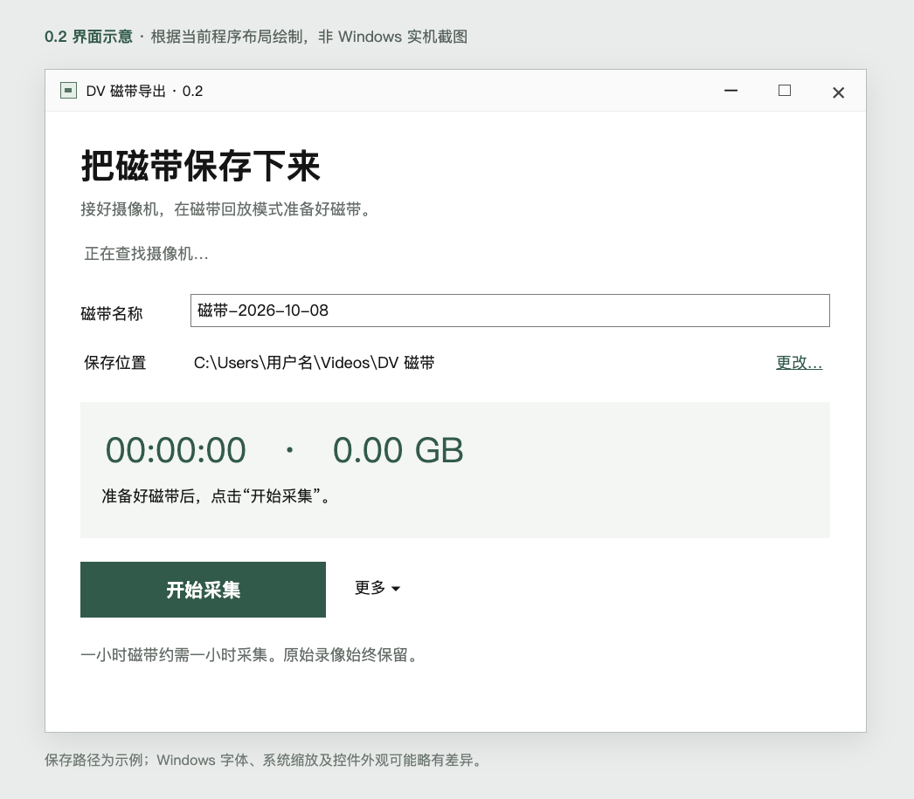

# DV 磁带导出 · DV Tape Exporter

一个简洁的 Windows x64 桌面工具，通过兼容摄像机的 USB MotionDV 连接，把 MiniDV 磁带保存为原始 DV，并生成便于播放的 MP4。

**[下载 Windows 便携版](https://github.com/Eddddddddy/DV-Tape-Exporter/releases/latest)** · [完整使用说明](docs/使用说明.html) · [构建说明](src/BUILD.md) · [GPL-3.0-or-later](LICENSE)

当前版本 **0.2.0**。面向 Panasonic NV-GS28 的 MotionDV 工作流程，默认使用 Windows DirectShow，自动识别兼容的 DV 摄像机；不需要手动安装 Python 或 .NET 运行环境。建议使用 Windows 11 x64。USB 接口本身不代表可以导出磁带：摄像机需要支持 DV 数据传输并提供可用的系统驱动。其他机型的兼容性需要单独验证。

## 界面



上图按当前代码布局绘制，**不是 Windows 实机截图**。字体、系统缩放和控件外观可能略有差异。

## 开始使用

1. 从 [Releases](https://github.com/Eddddddddy/DV-Tape-Exporter/releases) 下载完整包，完整解压后运行 `DV-Tape-Exporter.exe`。
2. 摄像机接外接电源，切到**磁带回放**，USB 功能选择 **MotionDV**，再连接 USB。PC / 记忆卡模式不能读出磁带录像。
3. 等待主界面显示**已连接**。填写磁带名称，确认保存位置，然后点击**开始采集**。如设备不接受电脑播放指令，请在摄像机上按播放。
4. 导出从磁带当前位置开始。需要整卷导出时，先用摄像机按钮或**更多 → 倒带到开头**倒带，并确认倒带已停止。
5. 结束时点击**停止并保存**。软件保存已收到的原始 DV，然后默认转换为 MP4。一小时录像需要约一小时采集，建议每小时预留至少 **18 GB**，保存盘使用 NTFS 或 exFAT。

首次生成 MP4，需要通过**更多 → 下载播放文件组件**准备 FFmpeg。**原始 DV 采集可以离线进行。** 下载较慢时，可以把 Windows FFmpeg 7 或更新版本的完整目录放到程序的 `tools` 目录，保留许可证，并让 `ffmpeg.exe`、`ffprobe.exe` 位于同一个子目录。组件暂时不可用时，先保存原始 DV，之后通过**把已有录像转换为 MP4…**处理，无需重新采集。

## 功能与保存结果

- 自动识别并选择单台兼容摄像机；多台时从“更多”中选择。
- 主界面显示采集时长和已保存容量；同一个按钮负责开始、停止和取消转换。
- 原始 `.dv` 保留摄像机送来的数据、声音和元数据，不覆盖已有文件。
- MP4 使用 H.264/AAC，PAL 50p / NTSC 59.94p；保留两组立体声位置，缺失的音轨区间填充静音。
- 保存记录包含原始文件 SHA-256、格式检查、转换日志和播放文件检查结果。
- 关闭采集中的窗口会先结束采集并保存已收到的数据；取消转换始终保留原始 DV。
- 保存位置和选项保存在当前 Windows 用户的本地设置中。

默认不删除末尾画面。可选的末尾处理仅识别严格定义的停止占位数据，普通静止场景不会自动删除；原始 DV 始终保留。预计磁带时长只用于空间检查，采集保护上限为三小时。

**文件检查通过不代表摄像机画面没有花屏，也不代表已到磁带物理卷尾。** 手动停止、断线和超时均不视为卷尾；默认系统连接不能提供的丢包计数标记为未知。请保留原始 DV，并核对画面、声音和摄像机上的磁带位置。

## 验证范围

0.2 已完成 Windows x64 构建和离线回归，包括原始数据保存、停止收尾、中文路径、拒绝覆盖、取消转换和短 DV 的 FFmpeg 9.0.2 转换与整段解码。**本版新界面和摄像机连接尚未完成新的 Windows 实机复测。** 首次使用建议先采集约 30 秒并核对保存结果。便携包尚未代码签名。

## 开发与许可证

源码在 [`src`](src)，需要 .NET SDK 10。Windows 下从 `src` 运行：

```powershell
./build-windows.ps1
```

详细后端、测试和构建步骤见 [BUILD.md](src/BUILD.md)。默认使用 DirectShow；libusb 是高级兼容方案，主界面不会自动替换驱动。

整体项目采用 **GPL-3.0-or-later**。原生采集核心基于 Boris Timofeyenko 的 [uvcdv-capture](https://github.com/boris-timofeenko/uvcdv-capture)，保留上游版权和许可证。libusb 按 LGPL-2.1-or-later 分发，对应源码附在 [`src/third-party`](src/third-party)；Microsoft .NET、MinGW 和 winpthreads 声明一并保留。详见 [THIRD-PARTY-NOTICES.md](THIRD-PARTY-NOTICES.md)。FFmpeg 不随本项目分发，使用时从相应构建提供方获取并保留其许可证。

## 反馈

欢迎通过 Issues 提交机型、Windows 版本、连接方式和去除个人信息后的错误内容。不要上传私人录像、设备序列号、完整本机路径或未经清理的采集日志。贡献步骤见 [CONTRIBUTING.md](CONTRIBUTING.md)。

## English

DV Tape Exporter is a Windows x64 desktop utility for archiving MiniDV over a compatible USB MotionDV connection. It automatically discovers supported DirectShow DV devices, preserves the original raw DV stream, and optionally creates an H.264/AAC MP4 playback copy. Version 0.2.0 targets the Panasonic NV-GS28 workflow; other devices require individual compatibility testing. The updated UI has passed cross-build and offline checks but still needs a fresh Windows camera test. [Download](https://github.com/Eddddddddy/DV-Tape-Exporter/releases/latest) · [Build](src/BUILD.md). Licensed GPL-3.0-or-later.
